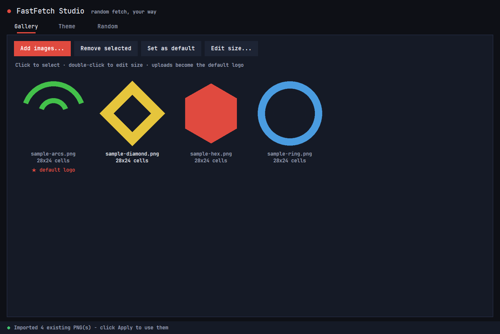

# FastFetch Studio

A small Windows app that makes your terminal greet you with [fastfetch](https://github.com/fastfetch-cli/fastfetch)
— using **your own picture** and **your own colours**, with a random logo and theme each time you
open a terminal.



## Quick start

1. **Install fastfetch and hook it into PowerShell** — paste this into PowerShell (no admin needed,
   safe to run again):

   ```powershell
   irm https://raw.githubusercontent.com/Kirisos-Guna/FastFetchStudio/main/setup.ps1 | iex
   ```

2. **Download `FastFetchStudio.exe`** from [Releases](../../releases) and run it. No install
   needed. If Windows SmartScreen warns you, click **More info → Run anyway**.

3. In the app, **add a picture** on the Gallery tab, pick your colours, then click
   **Apply & Generate**.

Open a new terminal — that's it.

> **Icons showing as `?`** — see [Icons need a Nerd Font](#icons-need-a-nerd-font).

## What you can do

- **Gallery** — add PNG, JPG, WEBP, GIF or BMP images, set their size, and pick a default.
- **Theme** — colours for each group of rows, the frame style and colour, and the separator.
- **Random** — choose what changes each time (logo, colours), how often (every window or once a
  day), and how the logo is drawn.
- **Preview in terminal** — see the result in a real Windows Terminal window before you apply.

Every row gets an icon, and 8 colour themes are made from your colours so the random pick has
variety.

## Hook it into PowerShell (one time)

`setup.ps1` (step 1 above) does this for you. To do it by hand, paste this into your `$PROFILE`
(replace any old fastfetch line):

```powershell
$ffLauncher = "$env:USERPROFILE\.config\fastfetch\fastfetch-random.ps1"
if (Test-Path -LiteralPath $ffLauncher) { & $ffLauncher } else { fastfetch.exe }
```

The app's Theme tab has the same snippet with a Copy button.

## Show it in Command Prompt too

Run this once in PowerShell. It is safe to run again, and it keeps anything already set up there
(such as Clink):

```powershell
$key  = 'HKCU:\Software\Microsoft\Command Processor'
$hook = '@if exist "%USERPROFILE%\.config\fastfetch\fastfetch-cmd.cmd" call "%USERPROFILE%\.config\fastfetch\fastfetch-cmd.cmd"'
if (-not (Test-Path $key)) { New-Item -Path $key -Force | Out-Null }
$old = (Get-ItemProperty -Path $key -Name AutoRun -ErrorAction SilentlyContinue).AutoRun
if ($old -match 'fastfetch-cmd') { $hook = $old } elseif ($old) { $hook = "$old & $hook" }
Set-ItemProperty -Path $key -Name AutoRun -Value $hook
```

It only draws in a Command Prompt window you opened yourself — never in the background `cmd`
runs that scripts and tools start. Each new window takes about half a second longer to open.

To turn it off:

```powershell
Remove-ItemProperty -Path 'HKCU:\Software\Microsoft\Command Processor' -Name AutoRun
```

## Icons need a Nerd Font

The row icons come from a [Nerd Font](https://www.nerdfonts.com/). Without one, every icon shows
as `?` in a diamond.

1. Download `CascadiaMono.zip` from the
   [Nerd Fonts releases](https://github.com/ryanoasis/nerd-fonts/releases) (it looks like Windows
   Terminal's default font).
2. Unzip it, select the `CaskaydiaMonoNerdFont-*.ttf` files, right-click → **Install**.
3. In Windows Terminal: **Settings → Defaults → Appearance → Font face → CaskaydiaMono Nerd Font**.
4. Close **every** Windows Terminal window and open it again.

## Troubleshooting

**Nothing shows when I open PowerShell.**
Windows blocks scripts by default. Allow them for your user (no admin needed), then open a new
window:

```powershell
Set-ExecutionPolicy -Scope CurrentUser RemoteSigned
```

**I see a Windows logo or a blocky picture instead of my image.**
Only some terminals can show real images. Use **Windows Terminal 1.22 or newer** (also works:
WezTerm, kitty, Ghostty). Other terminals get a block-character version of your picture. To
force the image anyway: Random tab → **Always draw the image, even in an unrecognised terminal**.

**The logo is missing or smaller in a narrow window.**
That's on purpose: the logo shrinks, or is left out, so the fetch never breaks. Widen the window.
`~\.config\fastfetch\gui\last-draw.txt` says what was drawn and why.

**The fetch shows up twice.**
Your `$PROFILE` has two fastfetch lines. Delete one (`setup.ps1 -Uninstall` removes the one setup
added).

### Alt+Enter (or any resize) tears the logo into bands

The fetch redraws itself at the new size within about half a second — you don't need to type
anything. It stops doing this once you have run a command, so it never wipes your output; type
`Redraw-Fetch` to bring it back any time. You can turn it off on the Random tab
(**Re-draw the fetch when the window is resized**).

If the picture still looks broken after the redraw, update Windows Terminal and your graphics
driver. If that doesn't help, add this to Windows Terminal's `settings.json`:

```json
"experimental.rendering.forceFullRepaint": true
```

## Files it creates

Everything lives in `~\.config\fastfetch\`:

| File | What it is |
|---|---|
| `config.jsonc` | the fastfetch settings (your original is saved once as `config.backup.jsonc`) |
| `themes\` | the 8 colour themes |
| `fastfetch-random.ps1` | the script that draws the fetch in PowerShell |
| `fastfetch-cmd.cmd` | the same, for Command Prompt |
| `pngs\`, `sixels\`, `arts\` | your pictures and their pre-made versions for the terminal |
| `gui\` | the app's own settings |

## Uninstall

1. Run `.\setup.ps1 -Uninstall` (add `-RemoveBinary` to remove fastfetch too).
2. If you set up Command Prompt, run the "turn it off" command above.
3. Delete `~\.config\fastfetch\` — or keep your pictures in `pngs\` and copy
   `config.backup.jsonc` back over `config.jsonc`.

More setup options: [SETUP.md](SETUP.md).

## Build from source

Needs Python 3.10+ on Windows.

```bat
build.bat
```

This runs the tests and builds `dist\FastFetchStudio.exe`. For development:

```bat
pip install -r requirements-dev.txt
python -m pytest tests/
python -m ruff check .
```

The app code is in `studio/`; `app.py` is the window. Pushing a `v*` tag builds the exe and
publishes a release.

## License

MIT — see [LICENSE](LICENSE).
